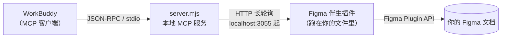

# workbuddy-figma

**让 WorkBuddy 直接读写你的 Figma 画布。**

不用 Figma 官方 MCP，不消耗 Dev Mode 配额，不是截屏点鼠标 —— 而是通过 Figma 开放的插件 API，
以本地插件的身份直接操作图层。画板、文字、组件、变量、自动布局、导出截图，全都能用。

[](https://nodejs.org)
[](LICENSE)
[](https://www.figma.com/plugin-docs/)

---

## 为什么需要它

| | Figma 官方 MCP | 截屏 + 模拟点击 | **本项目** |
|---|---|---|---|
| 需要付费席位 | ✅ 需要（Star 计划 / Dev Mode） | ❌ 不需要 | ❌ 不需要 |
| 消耗官方 MCP 额度 | ✅ 消耗 | ❌ 不消耗 | ❌ 不消耗 |
| 改分辨率后还能用 | ✅ | ❌ 坐标全废 | ✅ |
| 能改真实图层 | ✅ | ✅ 但极易点错 | ✅ |
| 读取图层结构 / 变量 | ✅ | ❌ 只能看图 | ✅ |
| 需要 Figma 桌面版 | ❌ | ✅ | ✅ |

Figma 的**官方 MCP**（`mcp.figma.com`）走 Dev Mode，免费账号进不去。
但 Figma 的**插件 API** 对所有账号开放 —— 只要这个文件里跑着一个本地开发插件，
它就能读能写整个文档。本项目就是把这个能力接到 WorkBuddy 上。

---

## 怎么工作



三句话：

1. WorkBuddy 启动时拉起 `server.mjs`，它是一个标准 MCP server，对外暴露 21 个工具。
2. `server.mjs` 在本机开一个小 HTTP 服务，等 Figma 插件来连。默认从 3055 起，**被占用就自动往后顺延**
   （最多 10 个端口），真实端口会同步写进插件里，不需要你手动对齐。
3. 你在 Figma 里运行一次插件，两边用一对本机随机 token 配对，之后就一直通着。

配对 token 是安装时现场生成的 32 字节随机数，只存在你本机，`install.mjs` 会把它注入到
`code.js` 里。每台机器生成的插件 id 都不一样，互不干扰。

---

## 安装

### 前置条件

- **Node.js ≥ 18**
- **WorkBuddy** 桌面版
- **Figma 桌面版**（网页版不支持导入本地开发插件）

### 一键安装

```bash
git clone https://github.com/kkse7en/workbuddy-figma.git
cd workbuddy-figma
node install.mjs
```

脚本会做四件事，全程自动：

1. 生成本机配对 token
2. 生成已配对的 Figma 插件，并打印 `manifest.json` 路径
3. 把 MCP server 写进 `~/.workbuddy/mcp.json`（**原文件自动备份**）
4. 如果检测到你装过 Figma 官方 MCP，会把它改名成 `figma-cloud` 并停用，避免冲突

想先看看会改什么，加 `--dry-run`：

```bash
node install.mjs --dry-run
```

换起始端口（默认从 3055 开始找空闲的）：

```bash
node install.mjs --port 3060
```

### 装完之后

**第一步 · 重启 WorkBuddy。** MCP 配置只在启动时读一次，不重启不生效。

**第二步 · 信任 MCP。** 打开连接器管理，找到 `figma`，点「信任」。
自定义 MCP 必须手动授权，这是 WorkBuddy 的安全设计，脚本改不了。

**第三步 · 让 Figma 认这个插件。** 两条路，推荐第一条：

**① 直接注册（推荐，跳过导入对话框）**

完整退出 Figma（含托盘图标），然后：

```bash
node install.mjs --register
```

它会把这个插件直接写进 Figma 的插件列表。重新打开 Figma，
`Plugins → Development` 里就会出现 `workbuddy-figma`，不用再选文件。

> 为什么推荐这条：Figma 的「Import plugin from manifest」对话框在部分环境下会对
> 本地路径报一句 `manifest.json 文件名无效`，但不说哪里无效。实测同样的 manifest
> 换个目录就能导入，是对话框自身的问题。直接写注册表可以完全绕开。
>
> 脚本会自动定位各平台的 Figma 配置：
> `%APPDATA%\Figma\settings.json`（Windows）、
> `~/Library/Application Support/Figma/settings.json`（macOS）、
> `~/.config/Figma/settings.json`（Linux）。

**② 手动导入**

```
Plugins → Development → Import plugin from manifest…
```

选 `install.mjs` 打印的那个 `manifest.json`，通常在：

```
~/Documents/workbuddy-figma-plugin/manifest.json
```

然后在**目标设计文件**里运行 `Plugins → Development → workbuddy-figma`。
会弹出一个窄条小窗口，**留着别关** —— 它一关，连接就断。

> 插件放在 `~/Documents` 而不是 `~/.workbuddy`：后者是隐藏目录，
> Figma 的文件选择器里不好找，部分版本还会挑路径。

### 验证

在 WorkBuddy 里说：

> 看看 Figma 连接状态

或者直接跑自检（不需要打开 Figma，会自己模拟一个插件）：

```bash
node selftest.mjs
```

看到 `全部通过 ✅` 就说明桥接链路没问题。

---

## 能做什么

### 管理工具（3 个）

| 工具 | 作用 |
|---|---|
| `figma_status` | 看连接状态、已连文档、插件版本。出问题先看这个 |
| `figma_setup` | 重新生成已配对的插件，返回 manifest 路径 |
| `figma_select_document` | 同时连了多个文件时，指定操作哪个 |

### 画布工具（18 个）

| 工具 | 作用 |
|---|---|
| **`use_figma`** | **在画布里直接执行 Figma Plugin API 脚本，读写都行。这是最核心的工具** |
| `get_selection` | 读当前页和选中的节点 |
| `get_metadata` | 读图层树（带分页，别一次拉整棵树） |
| `get_screenshot` | 导出真实 PNG 截图 |
| `get_design_context` | 读子树 + CSS，做设计稿转代码用 |
| `get_figjam` | 读 FigJam 结构 |
| `get_variable_defs` | 读设计变量 / 变量集合 |
| `search_design_system` | 搜本地组件、变量、样式 |
| `get_component_context` | 读组件、组件集、实例属性 |
| `get_libraries` | 读团队变量库 |
| `get_local_component_links` | 读本地组件与代码的映射 |
| `set_local_component_links` | 写本地组件与代码的映射 |
| `get_motion_context` | 读原型交互与动效数据 |
| `list_fonts` | 查可用字体族与字重 |
| `upload_assets` | 把本地图片 / SVG 导入为可编辑图层 |
| `download_assets` | 导出 PNG / JPG / SVG / PDF |
| `import_scene` | 用 JSON 场景导入原生节点 |
| `create_session` | 建一个本地任务记录（可选） |

---

## 用法示例

连接好之后，直接说人话就行：

> 看看我选中的画板，把主按钮统一成 40px 高、8px 圆角，改完给我截图。

> 参考这个深色界面，在新画板里做一个浅色版，文字和布局保留成可编辑图层。

> 读一下这个画板的图层结构，在当前项目里实现成 React 页面，素材导出到 assets 目录。

> 给这个按钮补上 hover 和 disabled 状态，颜色绑到对应的语义变量。

> 把这页所有 Frame 的间距从 40 改成 24。

---

## 连接稳定性

长轮询桥最怕的不是慢，是「看起来连上了但下一次就没反应」。下面这些点都会真实造成这种症状，已逐个修掉。

| 症状 | 原因 | 处理 |
|---|---|---|
| 连着连着报 `Failed to fetch` | Node 默认 `keepAliveTimeout` 只有 5s，会在两次 18s 轮询之间关掉空闲连接，Figma 的 fetch 复用到死 socket | 保活提到 65s，headers 70s 同步放宽 |
| 一次网络抖动就永久卡住 | 旧 poll 未回收时新 poll 直接返回 409，插件端断不开 | 新 poll 接管旧 poll（旧的以 `idle` 结束），不再 409 |
| 操作成功却被判「结果未知」 | 结果回传请求本身超时，重试被当成重复操作 | `/result` 幂等，重复回传返回 `accepted` |
| 同一个文件重开插件后一直超时 | 僵尸连接留在列表里，工具挑到了那条等不到响应的 | 新连接清掉同 `fileKey` 且在 30s 内无活动的旧连接 |
| 跑过一次自检后插件突然 401 | 自检和日常共用状态目录，把插件的端口/token 覆写了 | 自检改用独立状态目录 + 独立插件目录 |
| **「一直连接中」/「配对已失效」，但桥明明在跑** | 桥只绑 `127.0.0.1`，而 Figma 里的 fetch 走 `localhost`，Windows 会优先解析到 `::1` —— 请求落到了同端口上**另一个** Figma 桥（旧版 DSH / Codex 之类），token 自然对不上 | 桥改**双栈监听**（`::`，`ipv6Only: false`），Host 校验同时接受 `[::1]` |
| **桥整个没起来，工具一直报连不上** | 早期版本设了 `FIGMA_BRIDGE_PORT` 就只试那一个端口，被占就彻底放弃 | 任何时候都允许顺延 10 个端口，真实端口自动写回插件 |
| **重装后端口莫名跳到下一个** | 安装脚本靠 401 文案判断「是不是自己的桥」，但别的 Figma 桥文案一模一样，被误认为可复用 | 桥加 `x-workbuddy-figma` 响应头，按响应头识别身份 |

另外客户端退避改成了 300ms 起、最多 5s（原来 1s→10s，抖动一次像断了半分钟），
401 会先用当前密钥自动复验一次再报「配对失效」，
执行中断后的按钮也从「请重新打开插件」改成了可点的「恢复连接」。

---

## 常见问题

### 插件一直是「连接中 / 等待桥启动」

按顺序看：

1. **插件是不是旧目录那条？** `Plugins → Development` 里如果出现 `[DEPRECATED]` 前缀的条目，
   那是历史残留，token 对不上，点了也连不上。用不带前缀的 `workbuddy-figma`。
2. **桥在不在跑**：WorkBuddy 重启后才会拉起 `server.mjs`。
   在终端里确认一下（有 `x-workbuddy-figma: 1` 这个响应头才是我们的桥）：

   ```bash
   curl -i http://localhost:3060/health
   ```

   返回 401 + `x-workbuddy-figma: 1` 是正常的（401 只表示没带 token）。
   如果连不上、或者**没有这个响应头**，说明端口上蹲着别人的服务。
3. **端口对不对**：插件里的端口是生成时写死的。跑一次 `node install.mjs`，
   它会重新探测空闲端口并把插件同步过去，然后**重开插件窗口**（不是重新导入）。

### 报「配对已失效」

插件里的 token 和桥的 token 不一致。常见两种原因：

- **你运行的不是最新生成的那份插件**，或者状态目录被重新初始化过。
- **插件连到了另一个 Figma 桥**。同端口上如果蹲着别的实现（旧版 DSH / Codex 之类），
  它也会回一句 `Pairing token required`，但 token 不是你的 —— 表现就是「配对校验失败」。
  v1.2 起桥改双栈监听 + 响应头标识，这种撞车已经能自己让开；旧版本请升级。

```bash
node install.mjs
```

然后用它打印的 `manifest.json` 重新导入一次（或直接 `node install.mjs --register`）。
旧条目可以在 `Plugins → Manage plugins` 里删掉。

### Figma 报「manifest.json — 文件名无效」

**先别怀疑文件名。** 这个提示是 Figma 那个导入对话框的通用兜底文案，实测有两种触发场景：

| 场景 | 处理 |
|---|---|
| 这个插件 id 已经导入过，Figma 按 id 去重 | 别重复导入，直接在 `Plugins → Development` 里运行已有的那条；或 `node install.mjs --new-id` 换一个身份 |
| 对话框本身挑路径（同一份 manifest 换个目录就能导入） | 绕开对话框：`node install.mjs --register` |

`--register` 会直接写 Figma 的插件列表，前提是 **Figma 已完全退出** —— 否则它退出时会把整份配置覆盖回去。

### 端口被别的程序占了

`install.mjs` 会自己处理端口，通常不用你操心：

- 如果本项目的桥**已经在跑**，直接复用它的端口（重装不会把插件改到别处去）。
- 否则从 3055 起找第一个真的空闲的端口。判断「空闲」不只看能否 bind，
  还会发一次 HTTP 确认没人在服务 —— 因为 Windows 上别的程序只占 `127.0.0.1`
  时，`bind ::` 依然会成功，光看 bind 会把它当成空的。
- 十个端口全被占才需要显式指定：

```bash
node install.mjs --port 3080
```

判断端口上是不是自己的桥：

```bash
curl -i http://localhost:3055/health
```

有 `x-workbuddy-figma: 1` 响应头才是本项目的桥。**没有响应头就别复用这个端口**，
换个端口更省事 —— 两条桥挤在同一个号上，`localhost` 解析到哪一边是不确定的。

> 版本提醒：v1.2 之前桥只绑 `127.0.0.1`，遇到「只占 IPv4 的邻居」时，
> Figma 走 `localhost` 会优先落到 `::1`，请求就跑去别人那里了。
> 这类「明明在跑却一直连不上」的问题升级到这个版本即消失。

### 每次改完，画布都跳回第一页

插件契约规定 `use_figma` 每次从第一页开始。脚本里显式切页就行：

```js
const target = figma.root.children.find(p => p.name === '你的页面名')
await figma.setCurrentPageAsync(target)
```

### 报 `Previous operation outcome is uncertain`

上一次写操作失败后，桥接层会把文档标记为「状态不明」，防止你在未知状态上继续写。
先跑一次只读的 `get_metadata` 清除标记，再继续。

### 报 `Cannot access property children on a page that has not been explicitly loaded`

这个文件是 `documentAccess: "dynamic-page"` 模式，页面要先加载：

```js
await page.loadAsync()          // 或者 await figma.loadAllPagesAsync()
```

### WorkBuddy 里看不到 figma 工具

按顺序排查：① 重启过 WorkBuddy 吗 ② 连接器里点「信任」了吗 ③ 看 `~/.workbuddy/mcp.json`
里 `figma` 那项对不对。

### 插件显示「已连接」但没反应

先关掉多余的插件窗口。同一个文件开两个插件会产生两条连接，虽然新版会自动挑最近的那条并清理
30s 内无活动的僵尸连接，但保持只有一个窗口最省事。

---

## 安全说明

- 配对 token 是安装时本机随机生成的 32 字节，**只存在你本机**，不上传任何服务器。
- 桥只监听**回环地址**（`127.0.0.1` 与 `::1`，双栈是为了让 Figma 的 `localhost` 请求一定能回到自己人手上），
  并且校验 `Origin` 必须是 Figma 域名，外部访问会被拒。
- 生成的插件目录含**本机凭证**：默认在 `~/Documents/workbuddy-figma-plugin`，
  `companion/` 模板目录已在 `.gitignore` 里排除。别把生成物提交上去。
- 整个链路不经过任何第三方服务器，WorkBuddy → 本地 → Figma，三点直连。

---

## 项目结构

```
workbuddy-figma/
├── install.mjs          一键安装：生成 token、配对插件、写 MCP 配置、注册到 Figma
├── server.mjs           MCP stdio 服务端，21 个工具
├── selftest.mjs         端到端自检（自带假 Figma 插件，随机端口，不影响日常插件）
├── lib/
│   ├── bridge.mjs       HTTP 长轮询桥（双栈监听、连接、队列、超时、状态机）
│   ├── catalog.mjs      18 个画布工具的定义与 JSON Schema
│   ├── assets.mjs       素材读写（base64、SVG 校验、路径穿越防护）
│   └── companion.mjs    配对插件生成（注入 token、端口、插件 id）
└── companion/           Figma 插件资源（未配对模板）
    ├── manifest.json
    ├── code.js          跑在 Figma 沙箱里的主线程
    └── ui.html          插件 UI，通过 postMessage 与主线程通信
```

运行期产物（不进仓库）：

```
~/.workbuddy/workbuddy-figma/      配对 token、插件 id 的 salt
~/Documents/workbuddy-figma-plugin/  实际给 Figma 用的已配对插件（含本机 token）
```

---

## 与上游的关系

本项目基于 [DSH-to-Figma](https://github.com/Duoasa/DSH-to-Figma)（MIT，© 2026 Duoasa）。

复用了它的桥接协议、工具定义、素材处理和 Figma 伴生插件资源；
自己重写的是 MCP 服务端层（上游绑定了 DeepSeek Harness 的插件运行时，无法直接用于
WorkBuddy）、一键安装、端到端自检，以及针对 WorkBuddy 的适配。

上游项目的版权声明保留在 [LICENSE](LICENSE) 里。

---

## License

[MIT](LICENSE) © 2026 kkse7en
基于 [DSH-to-Figma](https://github.com/Duoasa/DSH-to-Figma) © 2026 Duoasa（MIT）
