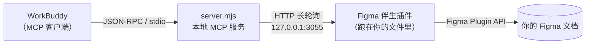

# WorkBuddy Figma

**让 WorkBuddy 直接读写你的 Figma 画布。**

不用 Figma 官方 MCP，不消耗 Dev Mode 配额，不是截屏点鼠标 —— 而是通过 Figma 开放的插件 API，
以本地插件的身份直接操作图层。画板、文字、组件、变量、自动布局、导出截图，全都能用。

[](https://nodejs.org)
[](LICENSE)
[](https://www.figma.com/plugin-docs/)

---

## 为什么需要它

| | Figma 官方 MCP | 截屏 + 模拟点击 | **本项目** |
|---|---|---|---|
| 需要付费席位 | ✅ 需要（Star 计划 / Dev Mode） | ❌ 不需要 | ❌ 不需要 |
| 消耗官方 MCP 额度 | ✅ 消耗 | ❌ 不消耗 | ❌ 不消耗 |
| 改分辨率后还能用 | ✅ | ❌ 坐标全废 | ✅ |
| 能改真实图层 | ✅ | ✅ 但极易点错 | ✅ |
| 读取图层结构 / 变量 | ✅ | ❌ 只能看图 | ✅ |
| 需要 Figma 桌面版 | ❌ | ✅ | ✅ |

Figma 的**官方 MCP**（`mcp.figma.com`）走 Dev Mode，免费账号进不去。
但 Figma 的**插件 API** 对所有账号开放 —— 只要这个文件里跑着一个本地开发插件，
它就能读能写整个文档。本项目就是把这个能力接到 WorkBuddy 上。

---

## 怎么工作



三句话：

1. WorkBuddy 启动时拉起 `server.mjs`，它是一个标准 MCP server，对外暴露 21 个工具。
2. `server.mjs` 在 `127.0.0.1:3055` 上开一个小 HTTP 服务，等 Figma 插件来连。
3. 你在 Figma 里运行一次插件，两边用一对本机随机 token 配对，之后就一直通着。

配对 token 是安装时现场生成的 32 字节随机数，只存在你本机，`install.mjs` 会把它注入到
`code.js` 里。每台机器生成的插件 id 都不一样，互不干扰。

---

## 安装

### 前置条件

- **Node.js ≥ 18**
- **WorkBuddy** 桌面版
- **Figma 桌面版**（网页版不支持导入本地开发插件）

### 一键安装

```bash
git clone https://github.com/jayk067123-max/workbuddy-figma.git
cd workbuddy-figma
node install.mjs
```

脚本会做四件事，全程自动：

1. 生成本机配对 token
2. 生成已配对的 Figma 插件，并打印 `manifest.json` 路径
3. 把 MCP server 写进 `~/.workbuddy/mcp.json`（**原文件自动备份**）
4. 如果检测到你装过 Figma 官方 MCP，会把它改名成 `figma-cloud` 并停用，避免冲突

想先看看会改什么，加 `--dry-run`：

```bash
node install.mjs --dry-run
```

换端口（默认 3055）：

```bash
node install.mjs --port 3060
```

### 装完之后

**第一步 · 重启 WorkBuddy。** MCP 配置只在启动时读一次，不重启不生效。

**第二步 · 信任 MCP。** 打开连接器管理，找到 `figma`，点「信任」。
自定义 MCP 必须手动授权，这是 WorkBuddy 的安全设计，脚本改不了。

**第三步 · 导入 Figma 插件。** 在 Figma 桌面端：

```
Plugins → Development → Import plugin from manifest…
```

选 `install.mjs` 打印的那个 `manifest.json`，通常在：

```
~/.workbuddy/workbuddy-figma/companion/manifest.json
```

然后在**目标设计文件**里运行 `Plugins → Development → WorkBuddy Figma`。
会弹出一个窄条小窗口，**留着别关** —— 它一关，连接就断。

### 验证

在 WorkBuddy 里说：

> 看看 Figma 连接状态

或者直接跑自检（不需要打开 Figma，会自己模拟一个插件）：

```bash
node selftest.mjs
```

看到 `全部通过 ✅` 就说明桥接链路没问题。

---

## 能做什么

### 管理工具（3 个）

| 工具 | 作用 |
|---|---|
| `figma_status` | 看连接状态、已连文档、插件版本。出问题先看这个 |
| `figma_setup` | 重新生成已配对的插件，返回 manifest 路径 |
| `figma_select_document` | 同时连了多个文件时，指定操作哪个 |

### 画布工具（18 个）

| 工具 | 作用 |
|---|---|
| **`use_figma`** | **在画布里直接执行 Figma Plugin API 脚本，读写都行。这是最核心的工具** |
| `get_selection` | 读当前页和选中的节点 |
| `get_metadata` | 读图层树（带分页，别一次拉整棵树） |
| `get_screenshot` | 导出真实 PNG 截图 |
| `get_design_context` | 读子树 + CSS，做设计稿转代码用 |
| `get_figjam` | 读 FigJam 结构 |
| `get_variable_defs` | 读设计变量 / 变量集合 |
| `search_design_system` | 搜本地组件、变量、样式 |
| `get_component_context` | 读组件、组件集、实例属性 |
| `get_libraries` | 读团队变量库 |
| `get_local_component_links` | 读本地组件与代码的映射 |
| `set_local_component_links` | 写本地组件与代码的映射 |
| `get_motion_context` | 读原型交互与动效数据 |
| `list_fonts` | 查可用字体族与字重 |
| `upload_assets` | 把本地图片 / SVG 导入为可编辑图层 |
| `download_assets` | 导出 PNG / JPG / SVG / PDF |
| `import_scene` | 用 JSON 场景导入原生节点 |
| `create_session` | 建一个本地任务记录（可选） |

---

## 用法示例

连接好之后，直接说人话就行：

> 看看我选中的画板，把主按钮统一成 40px 高、8px 圆角，改完给我截图。

> 参考这个深色界面，在新画板里做一个浅色版，文字和布局保留成可编辑图层。

> 读一下这个画板的图层结构，在当前项目里实现成 React 页面，素材导出到 assets 目录。

> 给这个按钮补上 hover 和 disabled 状态，颜色绑到对应的语义变量。

> 把这页所有 Frame 的间距从 40 改成 24。

---

## 常见问题

### Figma 报「manifest.json — 文件名无效」

**不是文件名的问题。** Figma 按插件 id 去重，这个插件你已经导入过了，重复导入就报这个错。
不用重新导入，直接在 `Plugins → Development` 里运行已有的那个。

### 每次改完，画布都跳回第一页

插件契约规定 `use_figma` 每次从第一页开始。脚本里显式切页就行：

```js
const target = figma.root.children.find(p => p.name === '你的页面名')
await figma.setCurrentPageAsync(target)
```

### 报 `Previous operation outcome is uncertain`

上一次写操作失败后，桥接层会把文档标记为「状态不明」，防止你在未知状态上继续写。
先跑一次只读的 `get_metadata` 清除标记，再继续。

### 报 `Cannot access property children on a page that has not been explicitly loaded`

这个文件是 `documentAccess: "dynamic-page"` 模式，页面要先加载：

```js
await page.loadAsync()          // 或者 await figma.loadAllPagesAsync()
```

### 报端口 3055 被占用

说明已经有一个桥在跑了（可能另一个 WorkBuddy 窗口，或者原来的 DSH 插件）。

```bash
# 看是谁占的
netstat -ano | findstr :3055
```

换端口重装：`node install.mjs --port 3060`，然后重新导入插件（端口写在插件里了）。

### WorkBuddy 里看不到 figma 工具

按顺序排查：① 重启过 WorkBuddy 吗 ② 连接器里点「信任」了吗 ③ 看 `~/.workbuddy/mcp.json`
里 `figma` 那项对不对。

### 插件显示「已连接」但没反应

关掉多余的插件窗口。同一个文件开两个插件会产生两条同名连接，互相抢任务。
（新版本会自动选最近的那条，但最好还是只留一个。）

---

## 安全说明

- 配对 token 是安装时本机随机生成的 32 字节，**只存在你本机**，不上传任何服务器。
- 桥只监听 `127.0.0.1`，并且校验 `Origin` 必须是 Figma 域名，外部访问会被拒。
- 生成的 `companion/` 目录**含本机凭证**，`.gitignore` 已经排除了它。别手动提交。
- 整个链路不经过任何第三方服务器，WorkBuddy → 本地 → Figma，三点直连。

---

## 项目结构

```
workbuddy-figma/
├── install.mjs          一键安装：生成 token、配对插件、写 MCP 配置
├── server.mjs           MCP stdio 服务端，21 个工具
├── selftest.mjs         端到端自检（自带假 Figma 插件）
├── lib/
│   ├── bridge.mjs       HTTP 长轮询桥（连接、队列、超时、状态机）
│   ├── catalog.mjs      18 个画布工具的定义与 JSON Schema
│   ├── assets.mjs       素材读写（base64、SVG 校验、路径穿越防护）
│   └── companion.mjs    配对插件生成
└── companion/           Figma 插件资源（未配对模板）
    ├── manifest.json
    ├── code.js          跑在 Figma 沙箱里的主线程
    └── ui.html          插件 UI，通过 postMessage 与主线程通信
```

---

## License

[MIT](LICENSE) © 2026 jayk067123-max
